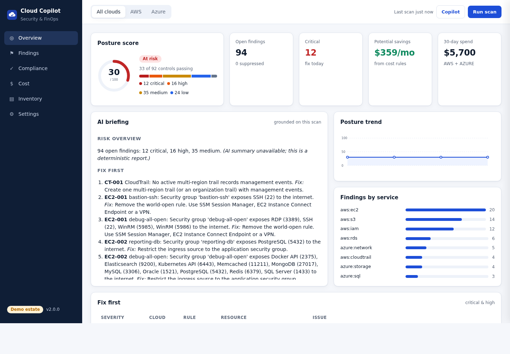
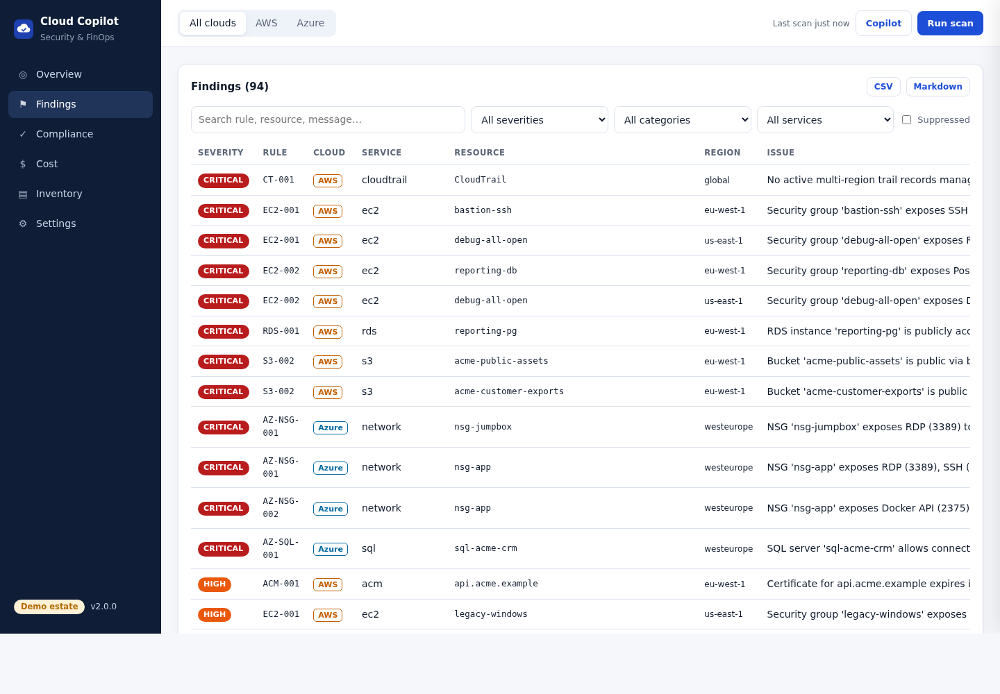
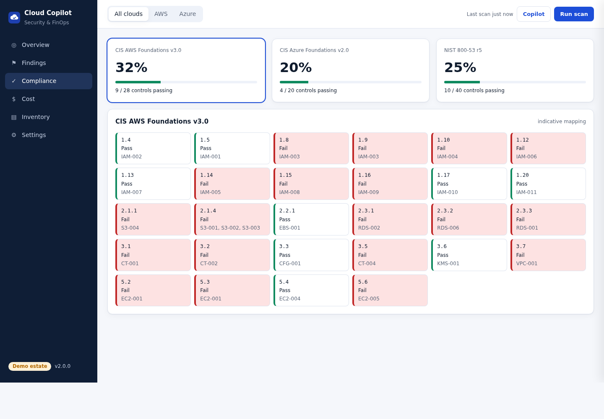
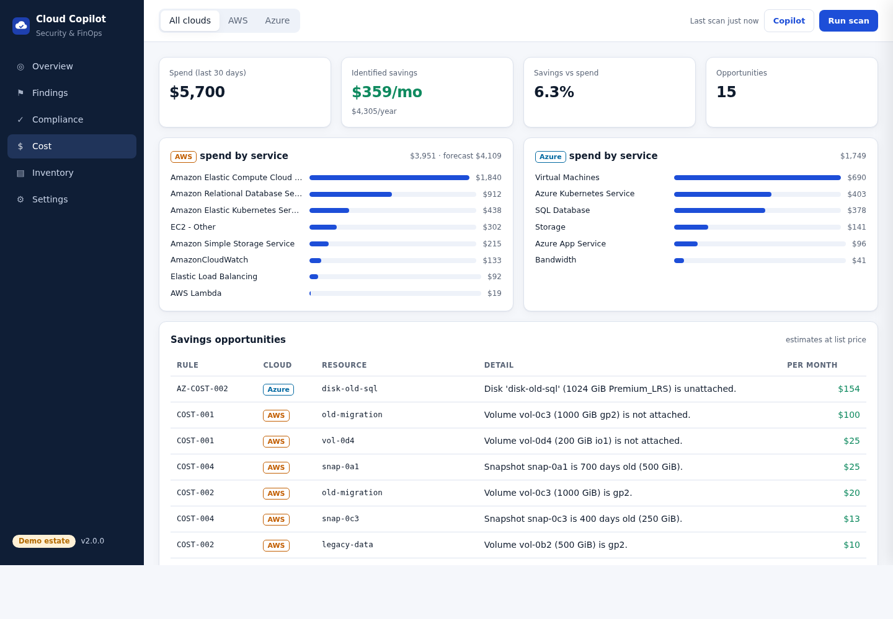
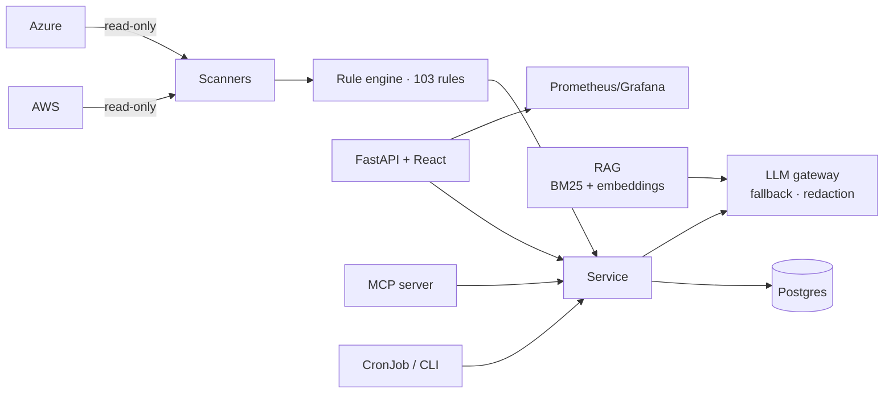

# Cloud Copilot

**Multi-cloud security & FinOps posture platform with an AI copilot.**
Scans AWS and Azure for misconfigurations and cost waste with 103 rules mapped to CIS and NIST. It explains the
results with a RAG-grounded LLM, and exposes everything to AI agents through an MCP server. It ships with a
full production DevOps stack: Docker, Helm, Argo CD, Terraform (EKS and Azure Container Apps), signed
images, and Prometheus/Grafana.

[](https://github.com/raeeed08/cloud-copilot/actions/workflows/ci.yml)
[](https://github.com/raeeed08/cloud-copilot/actions/workflows/release.yml)
[](https://github.com/raeeed08/cloud-copilot/actions/workflows/codeql.yml)




## Highlights

| | |
|---|---|
| **Rule engine** | 103 rules (70 AWS · 33 Azure) over 27 scanners: IAM, S3, EC2/EBS/VPC, CloudTrail, RDS, KMS, Lambda, GuardDuty/Config/Security Hub, ELB, EKS, ECR, DynamoDB, Secrets Manager, SQS/SNS, CloudWatch Logs, ACM · Storage, NSG, Key Vault, SQL, VMs/disks, App Service, Monitor, Defender, AKS, ACR |
| **Coverage** | every enabled region in parallel, every subscription, pagination, adaptive retries, per-service fault isolation |
| **Compliance** | CIS AWS Foundations v3.0, CIS Azure v2.0, NIST 800-53 r5 control status |
| **FinOps** | Cost Explorer / Azure Cost Management spend + 10 waste rules with estimated monthly savings |
| **AI copilot** | executive briefing and chat grounded by **RAG** (BM25 + optional embeddings, RRF) over playbooks and rule docs, with citations · model fallback chain · PII/ID **redaction** · prompt-injection guardrails · works offline |
| **MCP server** | 9 tools, 2 resources, 1 prompt, so Claude, Cursor or any agent can triage your cloud (stdio and streamable HTTP) |
| **Workflow** | scan history and trend, suppressions with reason and expiry, CSV/Markdown export, Terraform fix per finding, `--fail-on CRITICAL` CI gate |
| **DevOps** | multi-stage non-root image · Compose (Postgres, Prometheus, Grafana, Ollama, Jaeger) · Helm (HPA, PDB, CronJob, NetworkPolicy, ServiceMonitor, External Secrets, IRSA/WI) · Argo CD ApplicationSet · Terraform AWS (VPC, EKS, ECR, OIDC) and Azure (Container Apps, ACR, Key Vault) |
| **Supply chain** | GitHub Actions: ruff, mypy, pytest (277 tests, 85% coverage), Bandit, pip-audit, npm audit, gitleaks, Trivy, Checkov, tflint, kubeconform, CodeQL, e2e on **kind**, multi-arch build, **cosign** keyless signing, SBOM, SLSA provenance, GitOps promotion |

## Quick start (no cloud account needed)

```bash
# 1. local dev: demo estate, API + dashboard on http://localhost:8000
make install && make dev

# 2. or the full platform in containers
cp .env.example .env
docker compose up -d --build    # app :8000 · Grafana :3000 · Prometheus :9090 · MCP :8765/mcp
```

`DEMO_MODE=true` scans a synthetic AWS + Azure estate with the **real** engine, so every screen works without
credentials. Set `LLM_API_KEY` (OpenRouter, Groq, OpenAI…) or run `docker compose --profile local-llm up` for a
local Ollama. Without a model the copilot still answers from the rule engine and knowledge base.

## Scan real accounts

```bash
export DEMO_MODE=false
aws sso login --profile audit && export AWS_PROFILE=audit    # read-only: SecurityAudit + ViewOnlyAccess
az login                                                     # Reader + Security Reader + Cost Management Reader
uv run cloud-copilot scan --fail-on CRITICAL
```

The Terraform modules `infra/terraform/modules/aws-scanner-role` and `azure-scanner-identity` create exactly
these read-only identities (IRSA / workload identity / cross-account trust).

## Use it from an AI agent (MCP)

```bash
claude mcp add cloud-copilot -- uv --directory $PWD run cloud-copilot mcp
```
> *"Use cloud-copilot to triage my posture and give me the five most urgent fixes with Terraform."*

More clients: [examples/mcp-clients.md](examples/mcp-clients.md).

## Screens

| Findings | Compliance | Cost |
|---|---|---|
|  |  |  |

## Architecture



Details: [architecture](docs/architecture.md) · [threat model](docs/threat-model.md) ·
[rule catalogue](docs/rules.md) · [ADRs](docs/adr) · [security policy](SECURITY.md)

## Deploy

| Target | Command |
|---|---|
| Kubernetes (any) | `helm upgrade --install cc deploy/helm/cloud-copilot -f deploy/helm/cloud-copilot/values-demo.yaml` |
| Local kind cluster | `make kind` |
| AWS (EKS + Argo CD) | `cd infra/terraform/aws && terraform init -backend-config=backend.hcl && terraform apply`, then `kubectl apply -f deploy/argocd/` |
| Azure Container Apps | `cd infra/terraform/azure && terraform apply -var subscription_id=…` |
| CI only | enable `.github/workflows/posture-scan.yml` with `AWS_SCANNER_ROLE_ARN` (GitHub OIDC) |

Release flow: merge to `main` → image built (amd64/arm64), Trivy-scanned, cosign-signed, SBOM + provenance
attested → digest committed to `deploy/environments/staging.yaml` → Argo CD syncs staging → PR promotes prod.

## Develop

```bash
make check      # ruff, mypy, eslint, 277 tests + RAG eval, bandit, pip-audit, npm audit
make tf-check   # terraform fmt/validate (all stacks)
make docs       # regenerate docs/rules.md from the registry
```

Adding a check is one decorated function. The API, dashboard, compliance view, knowledge base and MCP pick it up
automatically:

```python
@rule(id="S3-004", title="S3 bucket allows plain HTTP", provider=AWS, service="s3",
      severity=Severity.MEDIUM, cis=["2.1.1"], nist=["SC-8"],
      description="...", remediation="...", terraform='...')
def tls_only(d):
    for b in d["buckets"]:
        if not b["policy"]["enforces_tls"]:
            yield Hit(f"arn:aws:s3:::{b['name']}", f"Bucket '{b['name']}' does not enforce TLS.")
```

## Tech stack
Python 3.12 · FastAPI · Pydantic v2 · SQLAlchemy 2 + Alembic · boto3 · Azure SDK · OpenAI-compatible LLMs ·
MCP SDK · React 18 + TypeScript + Vite · uv · Docker · Helm · Argo CD · Terraform · GitHub Actions · Prometheus ·
Grafana · OpenTelemetry · moto · pytest

## License
MIT
