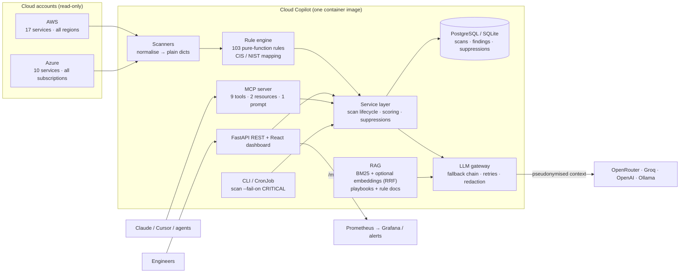
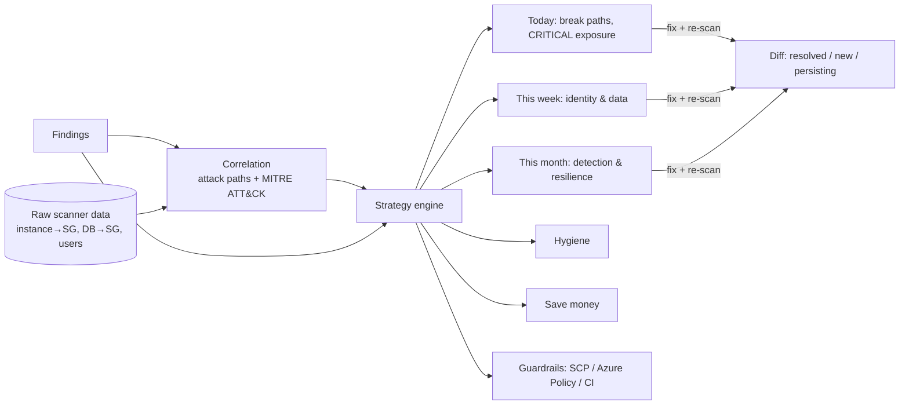
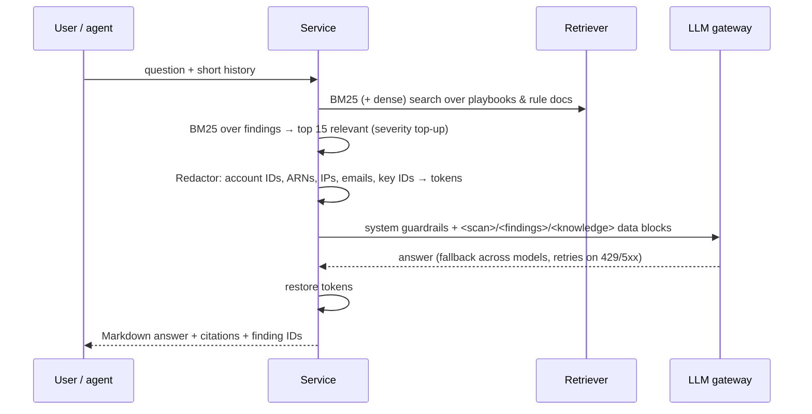

# Architecture

## Components



## Scan pipeline

1. **Context.** `AwsContext` resolves credentials (env, SSO, IRSA, instance role), the account ID and enabled
   regions. `AzureContext` uses `DefaultAzureCredential` (CLI, managed identity, workload identity).
   A missing provider raises `NotConfiguredError`, so its services are **skipped**, not failed.
2. **Scanners** (`@scanner(provider, service)`) fan out per region in a thread pool with adaptive retries.
   Region-level `AccessDenied`/`OptInRequired` become *warnings* (service status `partial`), never crashes.
3. **Rules** (`@rule(...)`) are pure functions `data -> Iterable[Hit]`. One buggy rule only marks its service
   `partial`. Every rule carries severity, category, rationale, remediation, Terraform, CIS and NIST controls.
4. **Findings** get a stable ID `sha256(rule|resource|region|account)`, so suppressions survive re-scans.
5. **Score** = severity-weighted share of *evaluated* security/reliability controls that pass.
6. **Persistence and metrics.** The scan, its findings and per-service health are stored, and Prometheus
   gauges are updated.
7. **AI briefing.** The top 30 findings (compact, pseudonymised) go to the LLM gateway. If no model is
   reachable, a deterministic report is generated instead.

## From findings to strategy



* **Correlation** (`core/correlation.py`) walks the raw normalised data per account, e.g. *instance with public
  IP* → *its security groups expose SSH* → *IMDSv1* → *instance role*, and emits a scenario with steps, MITRE
  technique IDs, impact and the single change that breaks the chain.
* **Strategy** (`core/strategy.py`) groups findings per rule into actions, assigns a phase (chain-breakers and
  CRITICAL first), estimates effort (S/M/L) and the exact posture-score gain, and picks guardrails for the rule
  families that failed. Deterministic and explainable; the LLM only narrates it.
* **Verification** (`Repository.diff`) compares a scan with the previous scan of the same targets.

## Connected accounts

Credentials are entered in the UI and stored **Fernet-encrypted** (`crypto.py`, key from `SECRET_KEY`); the API
returns only masked hints. `providers/accounts.py` turns an account into a scan context: AWS `assume_role`
(STS AssumeRole with External ID, recommended), `access_keys`, `profile` or ambient; Azure service principal or
`DefaultAzureCredential`. *Verify* calls STS `GetCallerIdentity` / lists subscriptions and stores the identity
and console sign-in URL. A scan can target any set of accounts; results are merged and re-scored.

## Copilot chat (RAG)



Retrieval quality is guarded by an offline eval (`tests/test_rag.py::test_retrieval_recall_at_3`, a golden
set of 12 questions, recall@3 ≥ 0.9) that runs in CI like any other test.

## Deployment topologies

| Target | How | Identity |
|---|---|---|
| Laptop | `make dev` or `docker compose up` (app, Postgres, Prometheus, Grafana, MCP; optional Ollama, Jaeger) | AWS profile / `az login` |
| Kubernetes (EKS/AKS) | Helm chart, Argo CD ApplicationSet (staging auto-sync, prod manual) | IRSA / Workload Identity |
| Serverless containers | Terraform `infra/terraform/azure` → Azure Container Apps + Key Vault | User-assigned managed identity |
| CI only | `.github/workflows/posture-scan.yml` nightly with `--fail-on CRITICAL` | GitHub OIDC → read-only role |

## Repository map

```
src/cloud_copilot/
  core/            registry (rules + scanners), engine, scoring
  providers/aws/   context, 4 scanner modules (17 services), 5 rule modules, Cost Explorer
  providers/azure/ context, scanners (10 services), rules, Cost Management
  providers/demo   synthetic estate used for demos and end-to-end tests
  llm/             gateway (fallback, retries, metrics), redaction, advisor (briefing + chat)
  rag/             corpus/chunking, BM25, dense index, RRF
  store/           SQLAlchemy models, repository, Alembic migrations
  api/             FastAPI app, security (API keys, rate limit), routes
  mcp/             MCP server
web/               React + TypeScript dashboard (Vite → served by FastAPI)
knowledge/         RAG playbooks (incident response, hardening, FinOps, DevSecOps, compliance)
deploy/            Compose stack, Helm chart, Argo CD, environment values, Grafana/Prometheus
infra/terraform/   AWS (VPC, EKS, ECR, IRSA, GitHub OIDC, Argo CD, ESO) · Azure (Container Apps, ACR, KV)
.github/workflows/ CI, release (sign/SBOM/provenance), CodeQL, nightly posture scan
```
